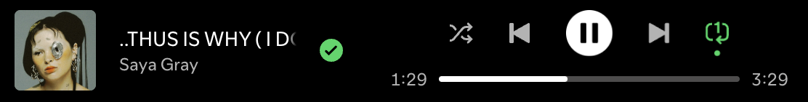

{: .center}

> you loved me differently
> i loved you all the same

sometimes i get obsessed with lyrics, and equally obsessed with the fact that nobody else understands the lyrics.

it's a double meaning: you loved me differently (not how i loved you, not normally). i loved you all the same (regardless)