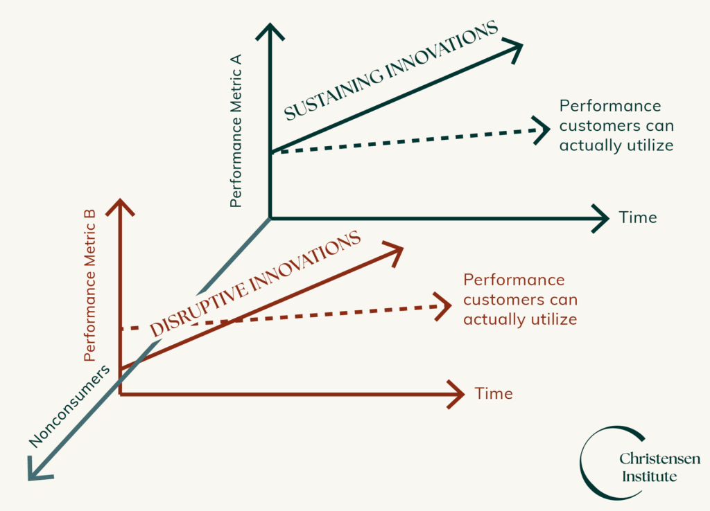
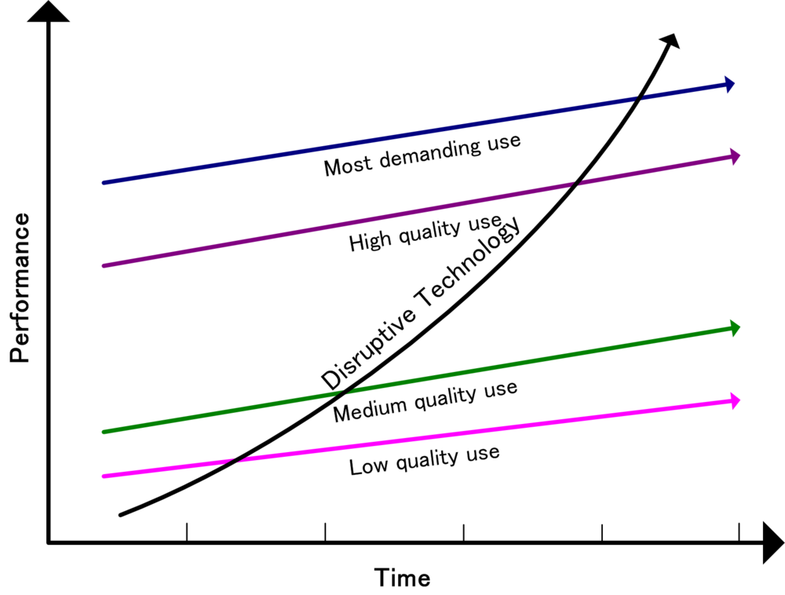
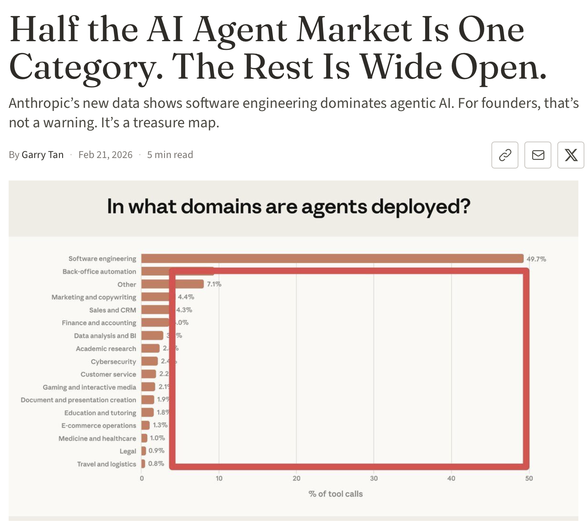

## Intro

If you spend any amount of time on startup social media (Hacker News, LinkedIn, …) you will be inundated with posts about AI tools that are being built and packaged as b2b SaaS products. From Lovable (and its innumerable copycats), to Harvey, to Agentforce, to Decagon. These are all products that are intended to be bought and used by incumbent players in large industries. These products have crazy initial growth curves, which signals people are willing to pay you a few bucks to demo your product, but always seem to peter off quickly. It’s just as hard for a large organization to adopt new tooling as it ever was.

Most people are missing out on the real opportunity of AI. AI is a technology that enables entirely new business models. The real winners of the AI wave will be people who figure out how to disrupt old industries by building AI-first companies.

We are building hi finance because we believe the best way to use AI in our space (financial services) is to build a new disrupting neo-bank, rather than by trying to sell technology to the old ones.

## What is Disruption?

Maybe first we should talk about what disruption *actually* means. Much to Clayton Christensen’s chagrin, disruption is an often misused term. So, for him, I will take this opportunity to make sure there is at least one essay with the correct definition.

  <figure style="flex: 1; margin: 0; text-align: center;">
    
    <figcaption>The hardest part of explaining disruption is that nobody has ever been able to figure out how to draw a good graph of it (source: idk, google images?)</figcaption>
  </figure>
  <figure style="flex: 1; margin: 0; text-align: center;">
    
    <figcaption>This one isn't any good either (source: Wikipedia)</figcaption>
  </figure>

Gemini and/or Webster defines disruption as: A business that *challenges established market leaders by introducing products, services, or business models that are initially simpler, cheaper, or more accessible to a previously overlooked market segment, eventually moving upmarket to displace incumbents*

But for people who speak human: **It’s a business that figures out how to offer a cheaper product to customers that the other big companies are overlooking.**

**The timeline is something like:**

1. You launch a smaller, cheaper version of something into an established market. Maybe with one or two novel features
2. Initially the larger company doesn’t really care about you, they have a premium product, and sell it for more money, why would they care?
3. As you start to gain momentum you move slowly upwards in the market, offering higher value services based on your fundamentally lower cost product.
4. The large business feels pressure to retain their customers, and does so by building a bigger and better and more premium version. They manage to keep their customers, but only do so by moving even further up into the market
5. The new company pushes them higher and higher until they’ve starved themselves of anyone able or willing to adopt their product
6. The new company is now the large company

My classic example of this is IBM vs AWS. AWS began by offering a DIY low cost cloud hosting to anybody, the big boy IBM basically laughed at them. As they grew and grew, they slowly pushed IBM up in the market, until now when IBM serves a few very large premium customers, while AWS (and competitors) serve almost everybody.

Anyways the takeaway here is: If you figure out how to grow a market exponentially by offering a lower cost version of a premium service, you can follow the disruptive playbook and eat the big boys.

## What's actually working in AI today?

So that's the actual ball game. Find a place where AI can be used to build a company that can disrupt an existing industry. It's significantly less sexy than yet-another-B2B-SaaS-app, but ultimately it captures actual value in the market.

So then how can we find industries that are good for AI to disrupt? That's the million dollar question I suppose. But I think the right place to start is look at what AI is *actually* good at today. The most successful AI category (other than ChatGPT itself) so far, is the coding copilot (cursor, github, etc).

[Source: Garry Tan the president of YC. Although I think he is sourcing Anthropic's data](https://garryslist.org/posts/half-the-ai-agent-market-is-one-category-the-rest-is-wide-open)

Cursor is a tool that literally multiplies the output of an expert in their field. Genuinely not trying to toot my own horn, but I am a very effective developer. I have been doing this for 20 years, I would classify myself in the meme-worthy 10x developer bucket. Using a coding copilot literally doubles or triples my output. The companies I work at literally need to hire 3x fewer software engineers because I have access to this tool.

Cursor is an early indicator of what will win in the AI game. Today, the actual product that AI enables is Co-pilots, not Agents. It takes an expert in a field, and allows them to multiply their output.

But outside of software engineering, nobody has really pulled this off yet — and that's where the opportunity is.

## Cost structures, business models, block progress

So why is Cursor a successful product while the other co-pilots are slower in growth? The primary reason is business model. Software Engineering was already a job where individuals were incentivized to be more efficient than their peers. A Software Engineer can literally get paid more if they can output more.

Other industries have weird structures that prevent order-of-magnitude shifts in productivity without completely new business models: i.e., lawyers get paid by the hour, they can’t make their time more efficient.

In financial services it’s a bit more complicated: Financial Planners are already a very high-end premium product. You pay 1% of your wealth per year for life to have a Financial Planner work on your finances. A good planner is incentivized to offer an extremely premium service to very few customers. A Co-Pilot doesn't fit as well into this model.

**So instead of building a copilot for financial planners, we're pursuing disruption.**

## What is hi finance building instead?

hi finance’s strategy is a bit different. Our strategy is based on two different ideas:

1. **What we built:** We figured out that we could offer great financial advice for much, much cheaper
2. **What we realized:** Dramatically cheaper financial advice opens up a brand new market: Young Adults

Or to put it another way: We figured out technology that allowed us to offer great financial advice for much less money. We realized this allows us to give good advice to young adults (post-secondary students), a market that the incumbents don't pay much attention to. Instead of trying to convince big-banks that they should also be helping students, we decided to do it ourselves.

---

## Come build with us

We're hiring engineers who want to build the future of financial services. If this post resonated with you — if you want to work at a company that's using AI to disrupt an industry rather than just selling tools to one — we'd love to hear from you.

Check out [Engineering Culture at Hi Finance]() to learn more about how we work and what we're looking for. If you're interested, reach out to me at mike@hifinance.ca

**More from the blog:**

- [AI Doesn't Change the Job of a Software Engineer]() — Writing code is not, and has never been, the main job of a Software Engineer.
- [Engineering Culture at Hi Finance]() — What we're building, why we're building it, and the values driving how we build it.
