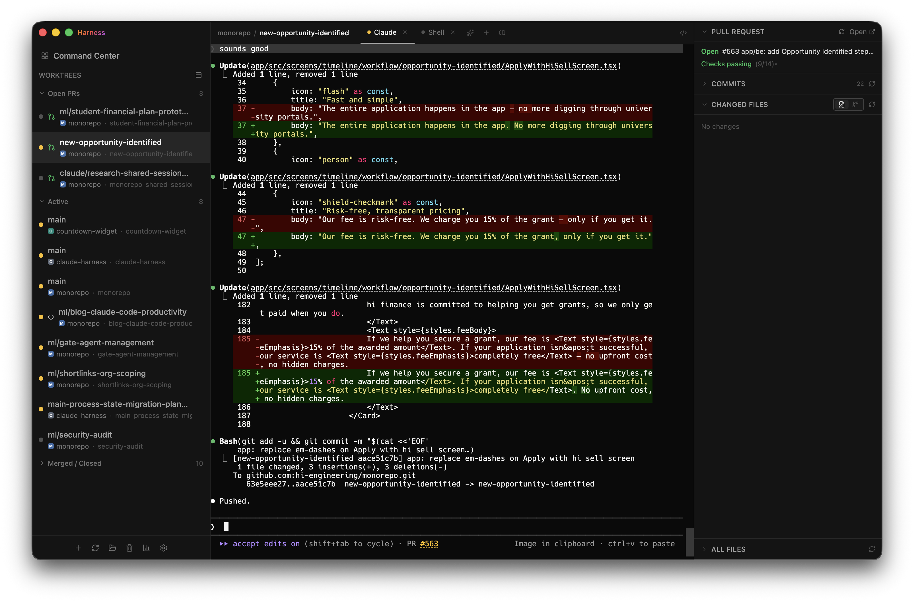

Claude Code is really good. It is good enough that I spend most of my day not typing code, I spend it shepherding four or five Claudes doing different things at once. Which is great! Except it also means the parts of my workflow that were "fine" when I had one thing going suddenly aren't fine at all.

I wrote a while back that [AI doesn't change the job of a software engineer](), and I still believe that. The job is still to listen to your users and imagine something better for them. But the flip side of "the job doesn't change" is that **mastering your tools matters as much as it ever did** — maybe more, because the tools got a lot more powerful. Claude just turned the dial up to 11 on two specific skills that good engineers have always needed:

1. **Managing many projects/contexts at once.** If you can only hold one thing in your head, you are using maybe 20% of what Claude can do for you.
2. **Iterating as fast as possible on changes.** The slower your inner loop, the more of Claude's output sits in a queue waiting for you to look at it.

Both of these have always been good things for an engineer to be good at. But when you have one coworker who codes 5x faster than a human, **the cost of being bad at them goes way up**. So let me talk about the two tools we use at hi to not be bad at them.

## Managing many things at once

The first thing that completely breaks down when you are running many Claudes is, uh, knowing which Claude needs you right now. Three are working, one is waiting on a permission prompt, one finished 4 minutes ago and you didn't notice. Terminal tabs are not a good UI for this.

I have been using [Harness](https://harness.mikelyons.org) to solve this. Harness is a Mac app that runs Claude across as many git worktrees as you want, and shows you the status of each one at a glance. A dot for "working", a dot for "needs you", a dot for "done". You open it on your second monitor and you always know where to look next.

<figure class="post-figure" style="margin-bottom: 2rem;">
  
  <figcaption>Harness running against our monorepo. Sidebar lists every worktree with a status dot; the main pane is whichever Claude I'm currently paying attention to; the right pane shows the PR and changed files for that worktree. I leave this open on my second monitor all day.</figcaption>
</figure>

The key insight for me was that **finding the Claude that needs me** was actually the thing eating my day. Not prompting, not reviewing. Just the swivel-chair overhead of rotating between terminal tabs to check in. Harness took that to zero and I got a lot of my day back.

(Full disclosure, I know the guy who built Harness pretty well, which is to say: it's me. I built it because I needed it. If you've been feeling the same pain, try it out.)

## Iterating as fast as possible

The other thing that breaks is your review loop.

In the old world, when you wanted to actually test a PR, you'd `git checkout` the branch, run `yarn install`, boot up a dev server, maybe reset the DB, and finally click around. That's fine when you're reviewing one PR a day. It is **extremely not fine** when Claude is opening a PR every 20 minutes.

The fix is per-PR preview environments. Every PR in our monorepo automatically spins up its own frontend, its own backend, and its own mobile preview channel. Instead of cloning the branch, you click a link.

<figure class="post-figure" style="margin-bottom: 2rem;">
  

    

      
Before: one dev server

      

        
localhost:3000

        
↑ one at a time ↑

        

          
PR #1checking out…

          
PR #2waiting

          
PR #3waiting

          
PR #4waiting

        

      

    

    

      
After: a preview per PR

      

        
PR #1<code style="font-size: 0.65rem; background: transparent;">pr-1.preview</code>

        
PR #2<code style="font-size: 0.65rem; background: transparent;">pr-2.preview</code>

        
PR #3<code style="font-size: 0.65rem; background: transparent;">pr-3.preview</code>

        
PR #4<code style="font-size: 0.65rem; background: transparent;">pr-4.preview</code>

        
all live, all clickable, all at the same time

      

    

  

  <figcaption>Before, your dev server was a bottleneck you had to queue PRs through. After, each PR is a link.</figcaption>
</figure>

What this really buys you is not just speed, it's **parallel review**. Four Claudes can open four PRs and I can actually look at all four of them in the same fifteen minutes, instead of picking one and telling the other three to wait.

It also means non-engineers can review things. A designer opens a link. A PM opens a link. Our ops team can sanity-check a grant-application change before it ships to production. No cloning, no install, no setup. That was always nice, but with Claude opening PRs all day it's become load-bearing.

## So yeah

Neither of the ideas in this post is new. Managing many things at once is just good engineering. Fast iteration is just good engineering. But if you take "good at these" to "great at these", Claude Code gets dramatically more useful. The constraint stops being Claude and starts being you, and at that point the leverage is in your tooling, not your prompts.

If the tools in your workflow aren't letting you run multiple things in parallel, or aren't letting you iterate in seconds instead of minutes, **fix the tools**. That's the whole game now.

---

## Come build with us

We're hiring engineers who are excited about this kind of workflow. If running four Claudes in parallel sounds fun instead of terrifying, we should talk. Reach out to me at mike@hifinance.ca.

**More from the blog:**

- [AI Doesn't Change the Job of a Software Engineer]() — Writing code is not, and has never been, the main job of a Software Engineer.
- [Not Enough People Are Talking About AI-Enabled Disruption]() — The real winners of the AI wave will be people who disrupt old industries by building AI-first companies.
- [Engineering Culture at Hi Finance]() — What we're building, why we're building it, and the values driving how we build it.
